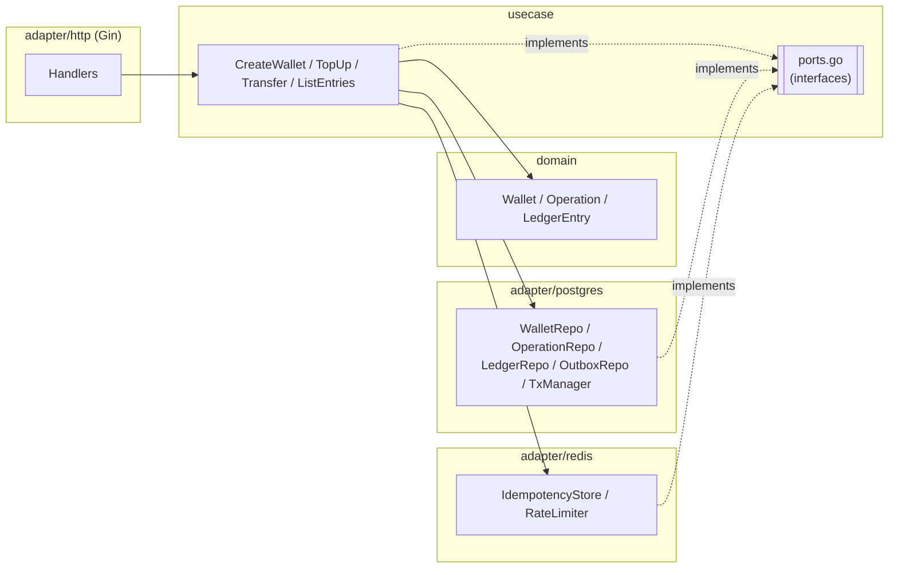

# go-wallet

A small, production-minded **wallet & ledger backend** in Go: create wallets, top them up, transfer money between them, and list a wallet's ledger — idempotent, concurrency-safe, and built on Clean Architecture so the business logic has zero framework dependencies.

Built for a Senior Golang Backend interview (code review / screen share): clarity, correctness under concurrency, and explicit trade-offs matter more than feature count.

**Live URL:** _not yet deployed — see "Remaining [HUMAN] steps" below._

---

## Architecture



Dependency rule: **adapter → usecase → domain**, never the reverse. Interfaces live in `internal/usecase/ports.go` (declared by the consumer) and are implemented by the Postgres/Redis adapters. `gin` is only imported by `internal/adapter/http` and `cmd/api`; `pgx` only by `internal/adapter/postgres` and `cmd/api`; `go-redis` only by `internal/adapter/redis` and `cmd/api`. Enforced by `make arch-check`.

---

## Run locally

Requires Docker and Go 1.27+.

```bash
make up            # starts postgres:16-alpine + redis:7-alpine
make migrate-up     # applies migrations/000001_init.up.sql
cp .env.example .env
make run            # go run ./cmd/api, loads .env
```

### Example requests

```bash
# Create two wallets
curl -s -X POST localhost:8080/v1/wallets -H "X-API-Key: local-dev-key" \
  -d '{"owner_id":"alice"}'
curl -s -X POST localhost:8080/v1/wallets -H "X-API-Key: local-dev-key" \
  -d '{"owner_id":"bob"}'

# Top up alice's wallet
curl -s -X POST localhost:8080/v1/wallets/$ALICE_ID/topup \
  -H "X-API-Key: local-dev-key" -H "Idempotency-Key: topup-1" \
  -d '{"amount":100000}'

# Transfer alice -> bob
curl -s -X POST localhost:8080/v1/transfers \
  -H "X-API-Key: local-dev-key" -H "Idempotency-Key: transfer-1" \
  -d "{\"from_wallet_id\":\"$ALICE_ID\",\"to_wallet_id\":\"$BOB_ID\",\"amount\":30000}"

# List bob's ledger
curl -s "localhost:8080/v1/wallets/$BOB_ID/entries?limit=20" -H "X-API-Key: local-dev-key"
```

Or run the full flow (including an idempotent replay check) with `scripts/smoke.sh http://localhost:8080 local-dev-key`.

---

## API

Base path `/v1`, JSON only. Auth via `X-API-Key` header (comma-separated allow-list in `API_KEYS`). Every response carries `X-Request-ID`.

| Method & path | Request | Success | Notes |
|---|---|---|---|
| `POST /v1/wallets` | `{"owner_id":"user-1"}` | `201` Wallet | |
| `GET /v1/wallets/:id` | — | `200` Wallet | bad UUID → `400` |
| `POST /v1/wallets/:id/topup` | header `Idempotency-Key`; `{"amount":100000}` | `200` `{"operation_id","wallet":Wallet}` | idempotent |
| `POST /v1/transfers` | header `Idempotency-Key`; `{"from_wallet_id","to_wallet_id","amount"}` | `201` `{"operation_id","from_wallet_id","to_wallet_id","amount","from_balance","to_balance","created_at"}` | idempotent |
| `GET /v1/wallets/:id/entries?limit=20&cursor=` | — | `200` `{"items":[Entry],"next_cursor":"..."\|null}` | cursor = base64url(UUID) |
| `GET /healthz` | — | `200 {"status":"ok"}` | liveness, no deps, public |
| `GET /readyz` | — | `200` / `503` | pings Postgres + Redis (2s timeout), public |

Wallet: `{"id","owner_id","currency","balance","created_at","updated_at"}`. Entry: `{"id","operation_id","direction","amount","balance_after","created_at"}`. A replayed idempotent response adds header `Idempotent-Replayed: true`.

Errors: `{"error":{"code":"INSUFFICIENT_BALANCE","message":"..."},"request_id":"..."}`.

---

## Design decisions & trade-offs

- **Clean Architecture, consumer-side interfaces.** `internal/domain` and `internal/usecase` import only stdlib + `google/uuid` — no `gin`, `pgx`, or `go-redis`. Repository/service interfaces live in `usecase/ports.go`, next to the code that calls them, and are implemented by adapters. This keeps business rules testable with plain in-memory fakes and lets the HTTP framework or driver be swapped without touching domain logic.

- **`TxManager` with tx-in-context.** `WithinTx` begins a transaction and stashes it in `context.Context` under an unexported key; repositories pull it out (or fall back to the pool) via a small `querier(ctx)` helper. This keeps the transaction *boundary* in the usecase (where the business operation is defined) without leaking a `pgx.Tx` type into `usecase` signatures.

- **Pessimistic row locking, ordered by ID.** `Transfer` and `TopUp` lock wallet rows with `SELECT ... WHERE id = ANY($1) ORDER BY id FOR UPDATE`. Locking in ascending ID order — regardless of which wallet is "from" and which is "to" — means two concurrent transfers in opposite directions (A→B and B→A) always acquire their locks in the same order, so neither can deadlock waiting on the other. We chose this over optimistic locking (would need a retry loop and still serializes under high contention on hot wallets) and over a Redis distributed lock (adds a second source of truth and a lock-expiry/fencing problem for no benefit, since Postgres already gives us transactional locking for free).

- **Idempotency: Redis fast path + DB constraint as source of truth.** The idempotency middleware uses Redis (`SETNX` + stored result) to short-circuit duplicate/in-flight requests cheaply. But correctness does not depend on Redis: `operations.idempotency_key` has a `UNIQUE` constraint, and the usecase layer handles the race where two requests both pass the Redis check and hit Postgres at the same time — the loser's insert fails with `23505`, which is mapped to `ErrDuplicateIdempotencyKey` and resolved into a replay. If Redis errors, the middleware fails open (logs a warning, lets the request through) rather than blocking all traffic on a cache outage; the DB constraint still prevents a double-spend.

- **Double-entry ledger + `balance_after`.** Every money movement writes one or two immutable `ledger_entries` rows (DEBIT/CREDIT) alongside the balance update, each recording the wallet's balance *after* that entry. This makes the ledger self-auditing: replaying a wallet's entries in order must reproduce its current balance (exercised by the concurrency integration test), and it gives a complete audit trail independent of the mutable `wallets.balance` column.

- **UUIDv7 for IDs → simple keyset pagination.** `uuid.NewV7()` IDs are time-ordered, so `ledger_entries(wallet_id, id DESC)` gives correct newest-first ordering and keyset (cursor) pagination — `WHERE id < $cursor ORDER BY id DESC LIMIT $n` — is both efficient (no OFFSET) and stable under concurrent inserts between page fetches (new rows get larger IDs, so they never show up "behind" an already-issued cursor).

- **Outbox written in the same transaction; relay deferred.** `transfer.completed` / `wallet.topped_up` events are inserted into `outbox` in the same DB transaction as the money movement, so the event can never be lost or published without the underlying change (or vice versa). A relay process to actually publish these (and mark `published_at`) is not implemented: on Cloud Run, a long-running background worker fights CPU throttling when the instance is idle between requests. In production I'd run the relay as a Cloud Run Job on a Cloud Scheduler trigger, or as a small min-instance worker service.

- **Rate limiting: fixed window.** `INCR`+`EXPIRE` (atomic via a small Lua script) per API key per UTC minute. Simple and cheap, with a known weakness: a client can send up to `2×limit` requests across a window boundary (e.g. the limit's worth at `:59` and again at `:00`). A sliding-window log or token bucket would close that gap at the cost of more Redis state/complexity; fixed window was the right trade for the time budget here.

- **Money as `int64` VND, single currency.** No floats anywhere in the money path, avoiding an entire class of rounding bugs. Multi-currency is out of scope (see below) but the schema's `currency CHAR(3)` and the usecase's currency-mismatch check are already in place for it.

---

## Testing strategy

- **Unit tests** (`make test`, `-race`): domain (`Debit`/`Credit` edge cases including overflow), usecase (table-driven, against hand-written in-memory fakes — including a `fakeTxManager` that snapshots/restores state to verify rollback on error), and HTTP (`httptest` + a real Gin router + fake usecases, covering every row of the error-mapping table, auth, and request-ID propagation). No mock-generator libraries; fakes are plain Go structs with function-field hooks for per-test error injection.
- **Integration tests** (`make test-integration`, `-race`, build tag `integration`): real Postgres 16 + Redis 7 via testcontainers-go (fallback to `TEST_DATABASE_URL`/`TEST_REDIS_URL` for environments where testcontainers itself can't run). Covers the properties unit tests can't: `TestTransfer_ConcurrentRandom` (100 goroutines × 20 random transfers among 5 wallets — asserts conservation of money, no negative balances, and that each wallet's ledger reconstructs its balance), `TestTransfer_NoDeadlockCrossDirection` (50×A→B and 50×B→A concurrently, bounded by a timeout), `TestTransfer_IdempotentConcurrentSameKey` (10 concurrent callers, same key → exactly one `operations` row), `TestTopUp_Idempotent`, `TestListEntries_KeysetPagination` (45 entries, pages of 20/20/5, no duplicates/gaps, stable under inserts between fetches), and `TestRedisIdempotencyStore`/`TestRedisRateLimiter` against real Redis.
- Everything always runs with `-race`, since this service's entire value proposition is concurrency correctness.

---

## What I'd do next

- **Auth:** replace static API keys with JWT/OAuth2 and per-tenant scoping.
- **Outbox relay:** a Cloud Run Job (Cloud Scheduler-triggered) or min-instance worker to actually publish `outbox` events and mark them `published_at`.
- **Observability:** `/metrics` (Prometheus) and OpenTelemetry tracing across the HTTP → usecase → Postgres/Redis path.
- **Multi-currency:** the schema and currency-mismatch check are already in place; would need an FX/conversion usecase and decide whether transfers across currencies are allowed at all.
- **Rate limiting:** upgrade fixed-window to a sliding window or token bucket to remove the boundary-burst weakness.
- **CD:** the optional `deploy.yml` (Workload Identity Federation + `deploy-cloudrun`, triggered on `v*` tags) described in the plan — not built in this pass (marked Could).

---

## Remaining [HUMAN] steps (Cloud Run deployment)

These require account/billing access this agent does not have:

1. Create a Neon Postgres project (region `aws-ap-southeast-1` / Singapore); copy the **direct (non-pooled)** connection string with `sslmode=require`.
2. Create an Upstash Redis DB (Singapore); copy the `rediss://` TCP URL.
3. Run migrations against it: `DATABASE_URL=<neon-direct-url> make migrate-up`.
4. In GCP: create a project, enable billing, enable the Cloud Run, Cloud Build, Artifact Registry, and Secret Manager APIs.
5. Create secrets `db-url`, `redis-url`, `api-keys`; grant the Cloud Run runtime service account `roles/secretmanager.secretAccessor`.
6. Deploy:
   ```bash
   gcloud run deploy go-wallet \
     --source . \
     --region asia-southeast1 \
     --allow-unauthenticated \
     --max-instances 2 \
     --set-env-vars GIN_MODE=release,DB_MAX_CONNS=5,RATE_LIMIT_PER_MIN=60 \
     --set-secrets DATABASE_URL=db-url:latest,REDIS_URL=redis-url:latest,API_KEYS=api-keys:latest
   ```
7. Run `scripts/smoke.sh <BASE_URL> <API_KEY>` against the deployed URL.

**Operational notes:** the app must listen on `$PORT` (it does — see `cmd/api/main.go`). Neon's free compute scales to zero, so the first request after idle is slower; warm it with a `/readyz` call before a demo. Keep `DB_MAX_CONNS` small, since Cloud Run can run multiple instances each holding their own pool.
