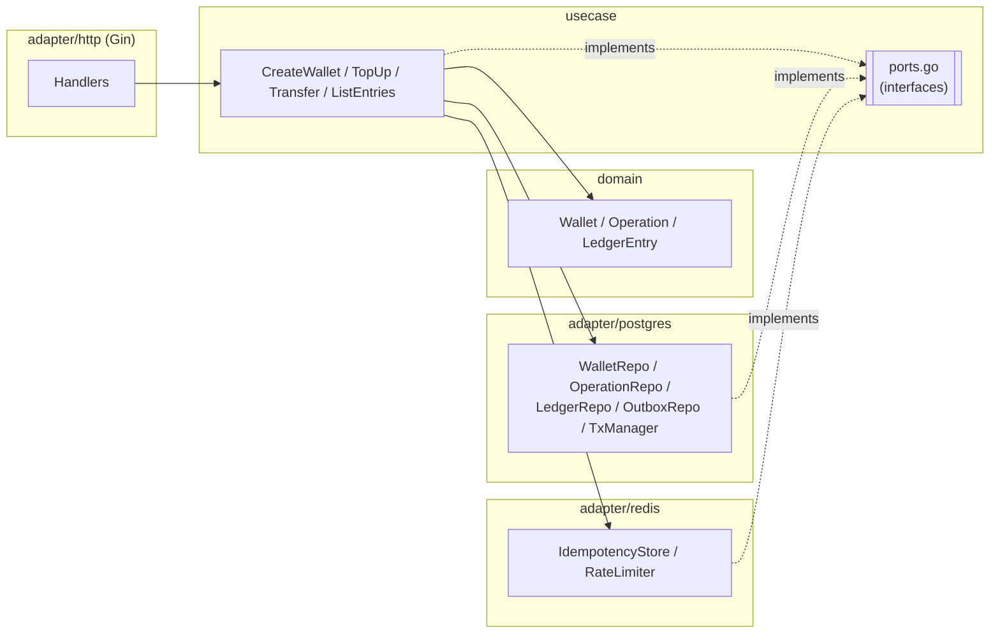

# go-wallet

A small, production-minded **wallet & ledger backend** in Go: create wallets, top them up, transfer money between them, and list a wallet's ledger — idempotent, concurrency-safe, and built on Clean Architecture so the business logic has zero framework dependencies.

Built for a Senior Golang Backend interview (code review / screen share): clarity, correctness under concurrency, and explicit trade-offs matter more than feature count.

---

## Architecture



Dependency rule: **adapter → usecase → domain**, never the reverse. Interfaces live in `internal/usecase/ports.go` (declared by the consumer) and are implemented by the Postgres/Redis adapters. `gin` is only imported by `internal/adapter/http` and `cmd/api`; `pgx` only by `internal/adapter/postgres` and `cmd/api`; `go-redis` only by `internal/adapter/redis` and `cmd/api`. Enforced by `make arch-check`.

---

## Run locally

Requires Docker and Go 1.27+.

```bash
make up            # starts postgres:16-alpine + redis:7-alpine
make migrate-up     # applies migrations/000001_init.up.sql
cp .env.example .env
make run            # go run ./cmd/api, loads .env
```

### Example requests

```bash
# Create two wallets
curl -s -X POST localhost:8080/v1/wallets -H "X-API-Key: local-dev-key" \
  -d '{"owner_id":"alice"}'
curl -s -X POST localhost:8080/v1/wallets -H "X-API-Key: local-dev-key" \
  -d '{"owner_id":"bob"}'

# Top up alice's wallet
curl -s -X POST localhost:8080/v1/wallets/$ALICE_ID/topup \
  -H "X-API-Key: local-dev-key" -H "Idempotency-Key: topup-1" \
  -d '{"amount":100000}'

# Transfer alice -> bob
curl -s -X POST localhost:8080/v1/transfers \
  -H "X-API-Key: local-dev-key" -H "Idempotency-Key: transfer-1" \
  -d "{\"from_wallet_id\":\"$ALICE_ID\",\"to_wallet_id\":\"$BOB_ID\",\"amount\":30000}"

# List bob's ledger
curl -s "localhost:8080/v1/wallets/$BOB_ID/entries?limit=20" -H "X-API-Key: local-dev-key"
```

Or run the full flow (including an idempotent replay check) with `scripts/smoke.sh http://localhost:8080 local-dev-key`.

---

## API

Base path `/v1`, JSON only. Auth via `X-API-Key` header (comma-separated allow-list in `API_KEYS`). Every response carries `X-Request-ID`.

| Method & path | Request | Success | Notes |
|---|---|---|---|
| `POST /v1/wallets` | `{"owner_id":"user-1"}` | `201` Wallet | |
| `GET /v1/wallets/:id` | — | `200` Wallet | bad UUID → `400` |
| `POST /v1/wallets/:id/topup` | header `Idempotency-Key`; `{"amount":100000}` | `200` `{"operation_id","wallet":Wallet}` | idempotent |
| `POST /v1/transfers` | header `Idempotency-Key`; `{"from_wallet_id","to_wallet_id","amount"}` | `201` `{"operation_id","from_wallet_id","to_wallet_id","amount","from_balance","to_balance","created_at"}` | idempotent |
| `GET /v1/wallets/:id/entries?limit=20&cursor=` | — | `200` `{"items":[Entry],"next_cursor":"..."\|null}` | cursor = base64url(UUID) |
| `GET /healthz` | — | `200 {"status":"ok"}` | liveness, no deps, public |
| `GET /readyz` | — | `200` / `503` | pings Postgres + Redis (2s timeout), public |

Wallet: `{"id","owner_id","currency","balance","created_at","updated_at"}`. Entry: `{"id","operation_id","direction","amount","balance_after","created_at"}`. A replayed idempotent response adds header `Idempotent-Replayed: true`.

Errors: `{"error":{"code":"INSUFFICIENT_BALANCE","message":"..."},"request_id":"..."}`.

---

## Testing strategy

- **Unit tests** (`make test`, `-race`): domain (`Debit`/`Credit` edge cases including overflow), usecase (table-driven, against hand-written in-memory fakes — including a `fakeTxManager` that snapshots/restores state to verify rollback on error), and HTTP (`httptest` + a real Gin router + fake usecases, covering every row of the error-mapping table, auth, and request-ID propagation). No mock-generator libraries; fakes are plain Go structs with function-field hooks for per-test error injection.
- **Integration tests** (`make test-integration`, `-race`, build tag `integration`): real Postgres 16 + Redis 7 via testcontainers-go (fallback to `TEST_DATABASE_URL`/`TEST_REDIS_URL` for environments where testcontainers itself can't run). Covers the properties unit tests can't: `TestTransfer_ConcurrentRandom` (100 goroutines × 20 random transfers among 5 wallets — asserts conservation of money, no negative balances, and that each wallet's ledger reconstructs its balance), `TestTransfer_NoDeadlockCrossDirection` (50×A→B and 50×B→A concurrently, bounded by a timeout), `TestTransfer_IdempotentConcurrentSameKey` (10 concurrent callers, same key → exactly one `operations` row), `TestTopUp_Idempotent`, `TestListEntries_KeysetPagination` (45 entries, pages of 20/20/5, no duplicates/gaps, stable under inserts between fetches), and `TestRedisIdempotencyStore`/`TestRedisRateLimiter` against real Redis.
- Everything always runs with `-race`, since this service's entire value proposition is concurrency correctness.

---